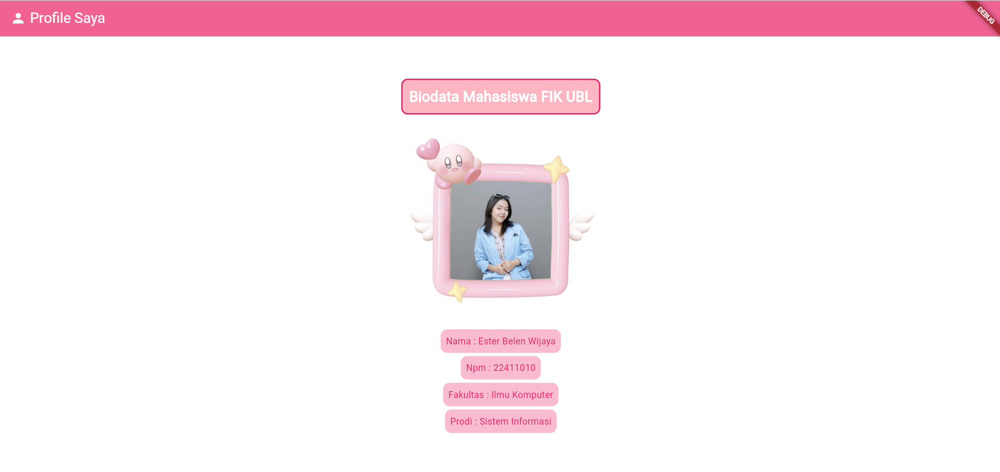

# Biodata Mahasiswa FIK UBL

Aplikasi biodata mahasiswa sederhana yang dibuat dengan Flutter sebagai tugas mata kuliah Pemrograman IV.

## Tampilan



## Fitur

- Halaman profil dengan AppBar "Profile Saya"
- Foto profil dengan bingkai
- Informasi nama, NPM, fakultas, dan program studi

## Teknologi

- Flutter
- Dart

## Cara Menjalankan

1. Pastikan Flutter SDK sudah terpasang.
2. Clone repository ini, lalu masuk ke foldernya.
3. Jalankan perintah berikut:

```
flutter pub get
flutter run -d chrome
```

## Struktur Singkat

- `lib/main.dart` : kode utama aplikasi
- `assets/` : foto yang dipakai di aplikasi

## Pembuat

Ester Belen Wijaya  
Sistem Informasi, Fakultas Ilmu Komputer, Universitas Bandar Lampung